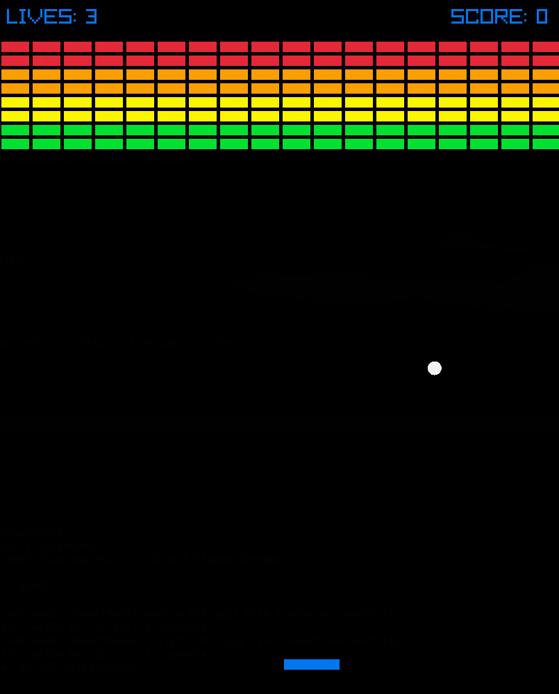

# Breakout
Breakout is classic old game develope and published in 1976 by Atari, Inc.

## Build from source

- First clone the repo:
```bash
git clone https://github.com/sanjar-xolmatov/Breakout
cd Breakout
```

- Install raylib
```bash
sudo pacman install raylib 
```

- Build
```bash
gcc main.c -o main $(pkg-config --cflags --libs raylib) -lm
```

- Run
```bash
./main
```

## Screenshots:

